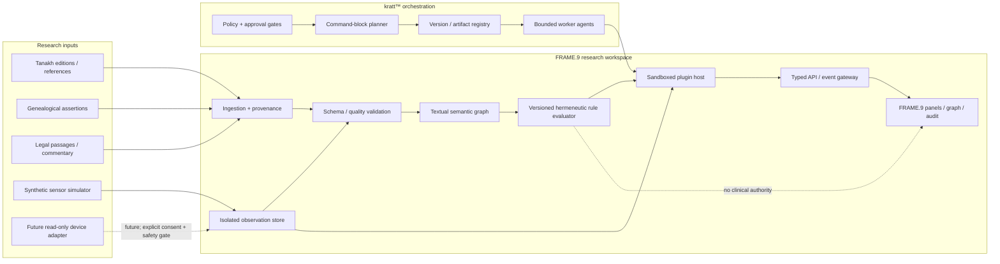

# FRAME.9 / 3XTRINITY neuro-semantic architecture
Version: 0.1.0 · Status: PROPOSAL / SIMULATION-ONLY · 30 October 2026

## 1. Purpose and implementation boundary

This document turns the supplied research brief into a staged architecture for FRAME.9, with a future shared contract for 3XTRINITY SOFTWARE and kratt™.

The prototype combines two **separate knowledge domains**:

1. **Textual-semantic domain** — Tanakh references, textual witnesses/editions, genealogical assertions, legal passages, commentary, and explicitly versioned hermeneutic rules.
2. **Device/biomedical domain** — synthetic or consented sensor observations, device metadata, signal quality, provenance, and safety events.

They may be correlated for research and visualization, but they are not interchangeable. A textual interpretation is not a clinical fact, diagnosis, treatment recommendation, device command, or evidence of physiological causality. The rule engine is not allowed to control a neurostimulator, implant, actuator, or patient-care workflow.

Initial FRAME.9 delivery is a **non-clinical research prototype**: synthetic sensor data only; no physical neurochip driver; no implant connection; no stimulation; no diagnosis; no clinical decision support; no production patient data. A future read-only hardware adapter would require a separately approved safety case and regulatory assessment.

## 2. Corrections to assumptions in the source brief

- Tanakh is conventionally described as Torah, Nevi'im and Ketuvim. Canon formation and book order are historical questions; do not model the tripartite structure as a single timeless universal schema.
- The traditional enumeration of 613 commandments is a rabbinic tradition with differing enumerations and scope. Store the source, enumerator, edition and interpretive status; do not hard-code a universal count.
- The 13 hermeneutical rules associated with Rabbi Ishmael are interpretive methods, not a deterministic, universally accepted legal inference engine. Each machine-applied rule must carry its source, scope, assumptions, confidence, counter-readings and human reviewer.
- “Genealogy” records are textual/historical assertions with provenance, not verified biological pedigrees. A source may describe a relationship without proving modern genetic parentage.
- IEEE 802.15.6-2026 is the current WBAN standard found in the official IEEE catalogue; the 2012 edition is marked inactive/reserved. A protocol's existence does not establish that a given implant supports it or that it is safe for a particular device.
- FHIR is an interoperability model, not a neuro-signal transport protocol. Use Observation/Device and related resources for appropriate clinical data exchange only after profiling and validation; keep high-rate raw signal transport in a separately specified stream.
- Regulatory classification depends on intended purpose, claims, functionality, risk and jurisdiction. Do not assume every neuro-related component is automatically Class III or that all software is a medical device.

## 3. System context



The textual graph and observation store have separate schemas, access policies, retention, and encryption domains. A cross-domain link is a typed, provenance-bearing research association; it is never an implicit join on a person's identity.

## 4. Logical layers and ownership

| Layer | Responsibility | Authoritative source | Prohibited responsibility |
|---|---|---|---|
| Source registry | Edition, publisher, URL, licence, retrieval date, checksum | Publisher / repository | Invent missing text |
| Text graph | Book, chapter, verse, person mention, assertion, relation, commentary | Cited text witness | Claim biological certainty |
| Hermeneutic registry | Rule definitions, preconditions, scope, version, examples | Primary/academic sources + reviewer | Unreviewed legal conclusion |
| Observation gateway | Device identity, timestamp, units, quality, consent, provenance | Device/simulator | Stimulation or treatment |
| Signal processing | Filtering, feature extraction, quality metrics | Versioned algorithms | Clinical diagnosis in this prototype |
| Plugin runtime | Capability-limited execution | Signed plugin manifest | Arbitrary host access |
| kratt™ | Plan, validate, stage, compare, rollback proposal | Policy + evidence ledger | Autonomous medical action |
| Audit/evidence | Commit, artifact hash, test, reviewer, decision | Git + CI + signed evidence | Treat a green label as proof of safety |

## 5. Canonical semantic model

Recommended entities:

- `TextWork`: canonical work identifier, tradition/canon, title, language.
- `TextEdition`: publisher, version, date, licence, language, checksum.
- `Passage`: stable reference (book/chapter/verse/segment), edition-specific locator.
- `PersonMention`: a named or unnamed person in a passage.
- `GenealogicalAssertion`: subject, predicate, object, passage, witness, assertion status, confidence, reviewer.
- `LawAssertion`: passage, tradition, classification, scope, source, interpretive status.
- `InterpretiveRule`: named method, source, formal preconditions, allowed conclusion types, version.
- `InterpretationRun`: inputs, rule version, output candidates, alternatives, reviewer, audit reference.
- `Device` / `Observation`: device class, modality, unit, timestamp, quality, synthetic/real provenance, consent reference.
- `CrossDomainAssociation`: references from semantic and observation domains with explicit research question and no clinical implication.

Use RDF/OWL or property graph for multi-parent, disputed and time-scoped relations. A relational projection is suitable for transactions and review queues. Never reduce a contested textual relationship to one unqualified `father_id`.

### Genealogy assertion example

```json
{
  "schemaVersion": "1.0.0",
  "assertionId": "tanakh:genesis:5:3:genealogy-001",
  "subject": "person-mention:seth",
  "predicate": "hasParent",
  "object": "person-mention-adam",
  "source": {
    "work": "Genesis",
    "reference": "Genesis 5:3",
    "editionId": "edition-id-required",
    "retrievedAt": "2026-10-30T00:00:00Z"
  },
  "assertionStatus": "textually-attested",
  "historicalConfidence": "not-assessed",
  "reviewStatus": "unreviewed"
}
```

This represents what a specified text says; it does not establish genetic parentage.

## 6. Hermeneutic rule execution

Represent each rule as data plus a reviewed evaluator. A rule record must include:

- stable rule ID and tradition/source;
- human-readable explanation and primary citation;
- formal preconditions and input types;
- permitted output types;
- explicit non-goals and prohibited inferences;
- version, test fixtures and counterexamples;
- reviewer and approval date.

The initial engine should return **candidate interpretations**, not a single authoritative answer. Every result must preserve the original passage, edition, rule version, intermediate steps, alternate interpretations and reviewer status. Conflicting readings are surfaced, not silently resolved by a priority score.

Do not encode “a third verse decides the conflict” as a universal machine rule. It is a tradition-specific interpretive formulation and needs a defined source and context.

## 7. Biomedical observation boundary

Initial simulator contract:

```json
{
  "schemaVersion": "1.0.0",
  "observationId": "sim-obs-000001",
  "sourceMode": "synthetic",
  "device": {
    "deviceId": "sim-device-01",
    "deviceClass": "synthetic-neuro-signal-source",
    "firmwareVersion": "sim-1.0"
  },
  "observedAt": "2026-10-30T00:00:00Z",
  "modality": "synthetic-electrophysiology",
  "sampleRateHz": 250,
  "unit": "uV",
  "samples": [0.1, 0.2, -0.1, 0.0],
  "quality": {"status": "simulated", "snrDb": null},
  "consent": {"status": "not-applicable-synthetic"},
  "clinicalUse": "prohibited"
}
```

Real-device ingestion, if ever approved, must be a separate adapter and deployment profile. Require device-specific interface documentation, manufacturer authorization, electrical/EMC/biocompatibility evidence as applicable, authenticated pairing, explicit consent, time synchronisation, loss handling, data minimisation and a hazard analysis. No generic “neurochip driver” may be loaded dynamically from an untrusted directory.

FHIR mapping is a downstream interoperability profile, not the raw streaming contract. Candidate mappings include Device and Observation, but profiles, terminology bindings, units, provenance and consent must be specified before use.

## 8. API and event contracts

Prototype endpoints (local/dev only; not deployed):

| Method | Route | Purpose | Access |
|---|---|---|---|
| GET | `/api/research/v1/catalog` | List text works and editions | Authenticated read |
| GET | `/api/research/v1/passages/{ref}` | Retrieve licensed/cached passage metadata | Authenticated read |
| GET | `/api/research/v1/graph/{entityId}` | Read provenance-backed graph neighborhood | Authenticated read |
| POST | `/api/research/v1/interpretations` | Request candidate interpretation | Reviewer-gated |
| POST | `/api/sim/v1/observations` | Submit synthetic observation | Dev/simulation only |
| GET | `/api/research/v1/runs/{runId}` | Retrieve run and evidence | Authenticated read |
| POST | `/api/kratt/v1/plans` | Validate a proposed command-block plan | Builder proposal only |

All write requests require schema validation, bounded payloads, actor identity, idempotency key, UTC timestamp, provenance and audit event. Use OpenAPI for REST contracts; WebSocket or MQTT is only considered for a later streaming profile with authentication, topic ACLs, replay protection, QoS/loss semantics and resource budgets.

## 9. Plugin contract and comparison

| Plugin class | Example | Capability scope | Default state |
|---|---|---|---|
| Text source | Sefaria adapter / licensed corpus importer | Network read to allow-listed source | Disabled until source and licence review |
| Text normalizer | Hebrew morphology / reference resolver | Text-only CPU/memory budget | Enabled in offline fixtures |
| Graph store | SQL / RDF adapter | Scoped DB namespace | Local test only |
| Hermeneutic evaluator | Rule pack: kal va-chomer etc. | Read graph; write candidate run | Human review required |
| Signal simulator | Synthetic waveform generator | Synthetic data namespace only | Enabled |
| Neuro device adapter | Manufacturer-specific read-only bridge | Explicit device + consent scope | Not implemented / blocked |
| FHIR gateway | Validated resource mapper | Healthcare endpoint allow-list | Not implemented |
| Audit signer | Artifact/evidence digest | Append evidence only | Planned |
| Agent worker | Bounded command-block execution | Per-task capabilities | Dry-run only |
| UI visualizer | Genealogy, parallel passage, signal-quality charts | Read-only API | Planned |

Every plugin must declare immutable version, digest, publisher, licence, SBOM, permissions, input/output schema, resource limits, network allow-list, data classification, health check, test suite, rollback compatibility and human owner. Prefer WASM or isolated process execution; do not load arbitrary `.so`, `.jar` or Python entry points into the FRAME.9 server process.

## 10. kratt™ hierarchy and command-block lifecycle

Hierarchy:

```
3XTRINITY root policy
  └── product (FRAME.9 / KRATT)
       └── environment (local / CI / staging / production)
            └── workspace
                 └── capability group
                      └── plugin instance
                           └── bounded worker task
```

Inheritance is deny-by-default. A child may narrow permissions but cannot widen a parent grant. Secrets are references to a vault, never literal values in a manifest. Production requires an independent approval and release identity.

Command-block states:

`DRAFT → SCHEMA_VALIDATED → POLICY_CHECKED → DRY_RUN → TESTED → APPROVAL_PENDING → APPROVED → STAGED → VERIFIED → ACTIVE`

Failure transitions to `REJECTED` or `ROLLBACK_PENDING`; rollback itself requires validation. Do not use `latest` image tags. Pin OCI images by digest and code by Git SHA. Duplicate worker tasks only when they are idempotent, have isolated output namespaces and a deduplication key. Consensus is for replicated state coordination, not a substitute for clinical safety approval or a multi-party human decision.

## 11. Safety, privacy and regulatory posture

This is an engineering planning section, not legal or regulatory advice.

- EU MDR 2017/745: intended purpose and function determine whether software is medical-device software and its classification. Obtain specialist qualification/classification analysis before making clinical claims or connecting to devices.
- GDPR: health data and certain biometric/genetic data are special-category data. Define Article 6 basis plus an applicable Article 9 condition, purpose limitation, minimisation, retention, access control, DPIA where required and data-subject rights.
- US FDA: if a product is a device or cyber device, assess the applicable premarket pathway and current cybersecurity guidance, including SBOM, vulnerability management and secure design evidence.
- HIPAA applies to covered entities and business associates in applicable roles; it is not a general certification for every health-data application.
- IEC 62304 provides a medical-device software lifecycle framework; ISO 14971 provides a risk-management process. They do not by themselves certify a product.
- ISO 13485 quality management, IEC 60601 electrical safety, IEC 62366 usability, ISO 10993 biocompatibility and other standards apply only where the device scope and regulatory strategy require them.
- Research involving people requires independent ethics review, informed consent and applicable clinical research controls. Do not run experiments on people or animals from this software project.

Security baseline: TLS in transit; encryption at rest; least privilege; per-device identity; short-lived credentials; key rotation/revocation; signed builds; SBOM; dependency and secret scanning; tamper-evident audit; threat modelling; secure update/rollback; no default credentials; no public exposure of local device agents.

## 12. KPI and failure-mode register

| KPI | Prototype target | Measurement |
|---|---:|---|
| Schema-valid synthetic events | ≥ 99.9% in deterministic test corpus | Accepted / submitted |
| Provenance completeness | 100% for published interpretation runs | Required provenance fields present |
| Reproducible interpretation run | 100% same inputs + same rule version produce same candidate set | Golden tests |
| Plugin permission violations | 0 | Denied capability events |
| Unpinned production artifacts | 0 | Release manifest audit |
| Rollback exercise success | 100% in staging drills | Restored prior known-good digest |
| Clinical/device control actions | 0 in prototype | API/event audit |
| Raw biomedical personal data in prototype | 0 | Dataset scan / fixture audit |

| Failure mode | Detection | Safe response |
|---|---|---|
| Invalid or disputed text reference | Reference and witness validation | Quarantine; preserve alternate witness |
| Conflicting hermeneutic outputs | Rule-run comparison | Surface disagreement; human review |
| Sensor dropout / bad quality | Sequence gap, quality threshold | Mark missing/invalid; never infer signal |
| Clock skew / replay | Timestamp window + nonce/sequence | Reject or quarantine; resync |
| Plugin crash / resource exhaustion | Health check, CPU/memory/time budget | Kill isolated worker; preserve audit |
| Compromised plugin or key | Signature/SBOM/identity alert | Revoke, disable, rollback to signed digest |
| Agent divergence | Evidence hash and policy mismatch | Stop rollout; no automatic consensus override |
| Database unavailable | Readiness and queue health | Fail closed; no unaudited writes |

## 13. Reference architecture for one-command deployment

One command should validate and stage a **non-clinical local simulation** only:

```sh
npm run trinity:validate
npm run trinity:simulate
```

The command must not deploy production, run migrations, contact a physical device, upload data, or enable network listeners. A later container-based environment may use a declarative manifest with pinned image digests and an explicit environment allow-list. No `latest` tags, device drivers or clinical service are part of this prototype manifest.

## 14. Delivery roadmap

| Stage | Deliverable | Exit gate |
|---|---|---|
| 0 — Architecture | This ADR, threat model, data boundaries, source register | Architecture review |
| 1 — Text corpus | Edition registry, passage IDs, provenance and genealogy assertions | Source and licence review |
| 2 — Rule engine | 3–5 rule packs, alternative interpretations, golden tests | Textual scholar review |
| 3 — Simulation | Synthetic signal source, observation schema, quality checks | Reproducible fixture tests |
| 4 — Plugin/kratt | Manifest validator, dry-run planner, permission matrix, rollback drill | Security review |
| 5 — API/UI | Read-only graph, comparison and signal-quality panels | Accessibility + integration tests |
| 6 — Regulatory discovery | Intended-purpose analysis, hazard analysis, jurisdiction mapping | Qualified regulatory/clinical review |
| 7 — Device research | Manufacturer-specific read-only adapter feasibility only | Separate signed safety case and approvals |

Indicative staffing for a serious biomedical product is not responsibly estimated from this brief alone. First complete a scoped feasibility study, device selection, intended-purpose statement, jurisdiction map, quality-system gap assessment and clinical/ethics consultation. A 2027–2029 commercial launch date or €2–3m budget is a hypothesis, not a validated forecast.

## 15. Open research questions

1. Which textual tradition, canon, language editions and manuscript witnesses are in scope?
2. Which genealogical relations are textual, traditional, historical or externally corroborated?
3. Which primary sources and scholarly editions define each hermeneutic rule?
4. Which use cases require RDF/OWL versus a relational projection?
5. What is the exact non-clinical intended purpose of the simulator?
6. Which sensor modality and manufacturer documentation would support a future read-only bridge?
7. What is the applicable device/software qualification in each target jurisdiction?
8. What data is personal, special-category, identifiable or re-identifiable in each deployment?
9. What reproducibility threshold is required for interpretive outputs?
10. What independent reviewers and ethics/regulatory partners are required before any human research?

## 16. Source register

1. EUR-Lex, Regulation (EU) 2017/745 (MDR): https://eur-lex.europa.eu/eli/reg/2017/745/oj/eng
2. European Commission, MDCG 2019-11 Rev.1 (2025), qualification/classification of medical device software: https://health.ec.europa.eu/system/files/2025-06/mdcg_2019_11_en.pdf
3. FDA, Cybersecurity in Medical Devices, final guidance (February 2026): https://www.fda.gov/regulatory-information/search-fda-guidance-documents/cybersecurity-medical-devices-quality-management-system-considerations-and-content-premarket
4. FDA, Cybersecurity FAQs / FD&C Act section 524B: https://www.fda.gov/medical-devices/digital-health-center-excellence/cybersecurity-medical-devices-frequently-asked-questions-faqs
5. HL7 FHIR R5 Observation: https://hl7.org/fhir/observation.html
6. IEEE 802.15.6-2026, Wireless Body Area Networks: https://standards.ieee.org/ieee/802.15.6/10941/
7. ISO, IEC 62304:2006 + Amd 1:2015: https://www.iso.org/standard/38421.html
8. ISO, ISO 14971:2019: https://www.iso.org/standard/72704.html
9. European Commission, GDPR legal grounds and special-category data: https://commission.europa.eu/law/law-topic/data-protection/information-business-and-organisations/legal-grounds-processing-data_en
10. Sefaria Developers, API overview and text API: https://developers.sefaria.org/reference/getting-started and https://developers.sefaria.org/reference/get-v3-texts
11. Oxford Academic, Reinhard G. Kratz, “The Books of the Hebrew Bible” (2015): https://academic.oup.com/book/27089/chapter-abstract/196435129
12. Timothy H. Lim, “How was the Canon Formed?” (2022): https://journals.sagepub.com/doi/10.1177/00145246221088365
13. “The Thirteen Rules of R. Ishmael,” Jewish Virtual Library (reference overview; verify against primary rabbinic sources): https://jewishvirtuallibrary.org/jsource/judaica/ejud_0002_0009_0_08805.html
14. NIST, AI Risk Management Framework: https://www.nist.gov/itl/ai-risk-management-framework

## 17. Implementation status

- Architecture document: this file.
- Real neurochip connection: NOT IMPLEMENTED.
- Clinical use / diagnosis / treatment: PROHIBITED in this prototype.
- Textual corpus ingestion: NOT IMPLEMENTED.
- Hermeneutic inference engine: NOT IMPLEMENTED.
- Synthetic observation schema and plugin manifests: planned in adjacent files.
- Production deployment / migrations: NOT AUTHORIZED.
